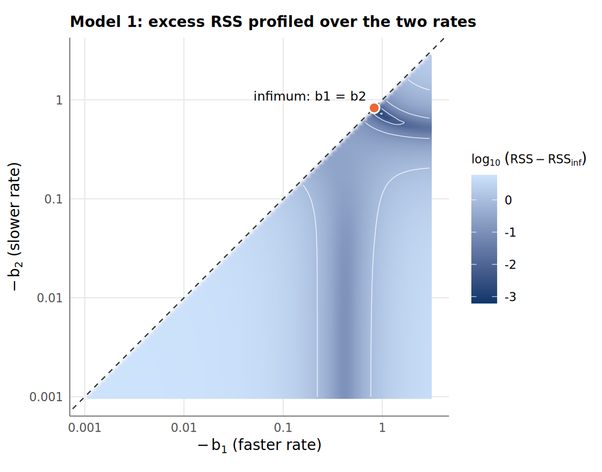
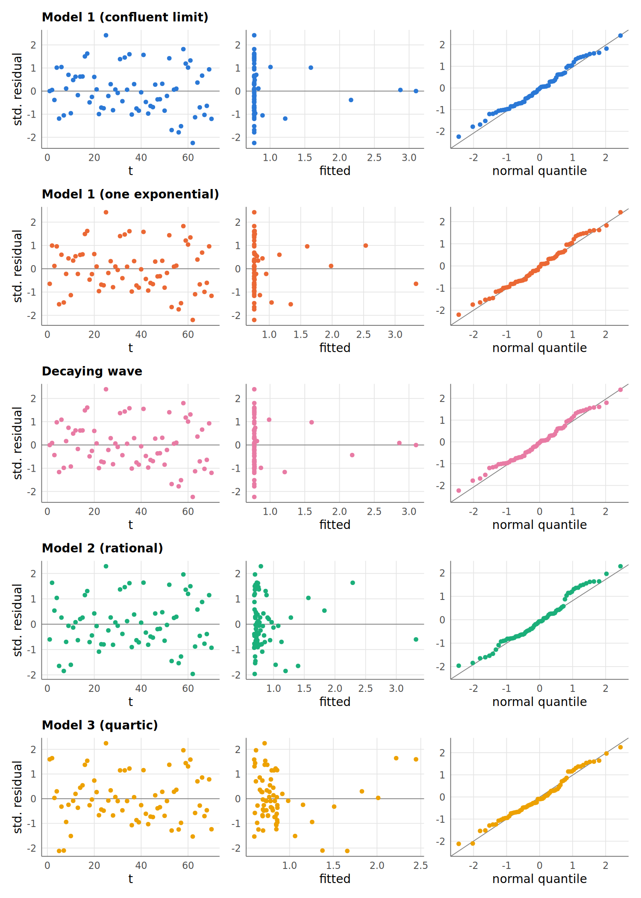
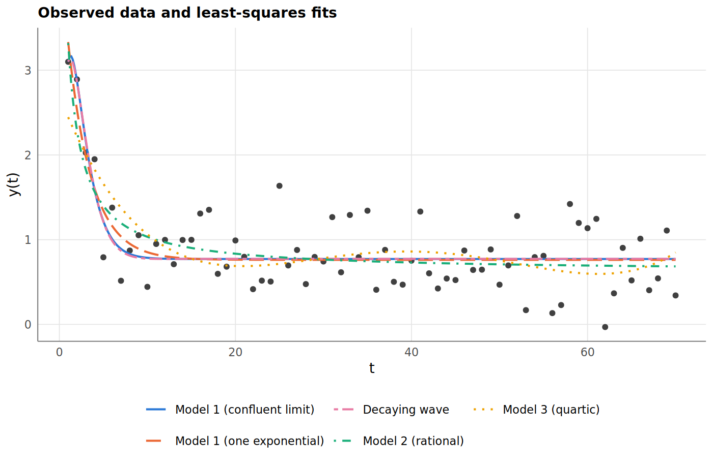
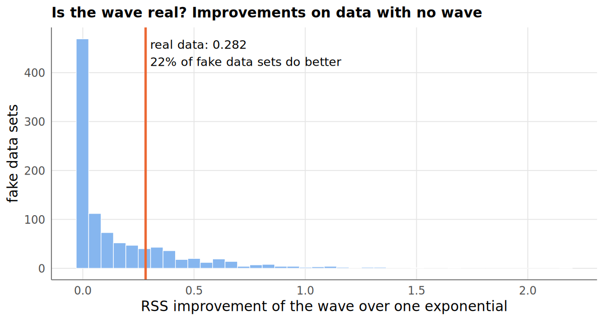

# Problem and summary

*This is a revised and extended version (October 2026) of the six-page report submitted on 12 November 2025. It adds the explanation of why Model 1's two-exponential fit breaks down, the Osborne cross-check, working profile-likelihood intervals, bootstrap intervals, and the two extensions in §10–11.*

Data set 94 consists of $n =$  observations $(t, y(t))$, $t = 1, \dots, 70$, assumed to follow one of

$$
\begin{aligned}
\text{Model 1:}\quad & y(t) = \alpha_0 + \alpha_1 e^{\beta_1 t} + \alpha_2 e^{\beta_2 t} + \varepsilon(t),\\
\text{Model 2:}\quad & y(t) = \frac{\alpha_0 + \alpha_1 t}{\beta_0 + \beta_1 t} + \varepsilon(t),\\
\text{Model 3:}\quad & y(t) = \beta_0 + \beta_1 t + \beta_2 t^2 + \beta_3 t^3 + \beta_4 t^4 + \varepsilon(t),
\end{aligned}
$$

with $\varepsilon(t) \overset{iid}{\sim} N(0, \sigma^2)$.

**Summary.** The data are best described by **Model 1**, but not in its two-exponential form. Model 1's least-squares estimator *does not exist* for this data set. The residual sum of squares decreases monotonically as the two rates merge ($\beta_2 - \beta_1 \to 0$) while $\alpha_1 = -\alpha_2 \to \infty$. Two independent methods confirm this: variable-projection Levenberg–Marquardt and Osborne's modified Prony algorithm. The infimum is attained by the *confluent* limit $\alpha_0 + (\alpha_1 + \gamma t) e^{\beta t}$. That limit in turn is not significantly better than a single exponential ($F =$ , $p =$ ), so the selected model is



Two technical points recur below:

- **Model 2 as stated is not identifiable.** Scaling $(\alpha_0, \alpha_1, \beta_0, \beta_1)$ by any $c \neq 0$ leaves the curve unchanged, so its Fisher information matrix is singular. We fix $\beta_0 = 1$.
- **All three models are partially linear**, which we exploit to reduce each non-convex search to one or two dimensions.

Two extensions follow the eight questions. §10 fits the *decaying wave* that Osborne's algorithm points to and checks whether the wave is real (it is not). §11 checks the whole method on simulated data where the right answer is known.

# Least-squares estimators (Q1)

Least-squares estimates minimise $S(\theta) = \sum_t \{y_t - \mu(t;\theta)\}^2$. The table gives each model's starting value (from Section 3) and final estimate. Model *M1c* is the confluent limit of Model 1 and *M1s* its one-exponential sub-model ($\alpha_2 = 0$). Model 2 uses $\beta_0 = 1$, so its parameters are $(\alpha_0, \alpha_1, \beta_1)$, written `a0, a1, b1`.

The *decaying wave* M1w (§10) is listed with the fits for completeness.



: Starting values and least-squares estimates. Row M1 is where Levenberg–Marquardt stopped after  iterations, *not* a converged estimate (see §3.2). {#tbl-est}

# How the estimators were found, and initial values (Q2)

## Variable projection

Each model is linear in its amplitudes once the nonlinear parameters are fixed. For Model 1, given $(\beta_1, \beta_2)$, the amplitudes $(\alpha_0, \alpha_1, \alpha_2)$ are the OLS coefficients of $y$ on $[1, e^{\beta_1 t}, e^{\beta_2 t}]$. Substituting them back gives a *profiled* criterion in the rates alone (Golub–Pereyra variable projection):

$$
S^*(\beta_1, \beta_2) = \min_{\alpha} S(\alpha, \beta) = y^\top (I - P_{X(\beta)})\, y .
$$

This turns a five-dimensional non-convex problem into a two-dimensional one that can be scanned exhaustively. We scanned 80 log-spaced rates in $[-3, -10^{-3}]$ with $\beta_1 < \beta_2$; Models M1c and M1s are profiled over one rate. Model 2 (with $\beta_0 = 1$) is linear in $(\alpha_0, \alpha_1)$ given $\beta_1$, so we profile over a 450-point grid of $\beta_1 > -1/70$, which keeps the denominator positive. The best grid point seeds a joint **Levenberg–Marquardt** refinement of all parameters with analytic Jacobians. Model 3 is linear and solved in closed form by QR.



: Convergence. The gradient norm is $\lVert J^\top r \rVert$ at the final iterate. {#tbl-conv}

M1c, M1s and M2 converge in at most  iterations (the wave M1w of §10 in ) to stationary points with gradient norm below , and their estimates move away from the grid starts. The grid only seeds the optimiser; it does not determine the answer.

## Model 1 has no interior least-squares estimate

Started from the best grid point, Levenberg–Marquardt on Model 1 never converges. It drifts steadily toward the boundary $\beta_1 = \beta_2$, with the amplitudes diverging in opposite directions while the RSS keeps decreasing:



: Levenberg–Marquardt trajectory for Model 1. {#tbl-div}

As $\beta_2 \to \beta_1$ with $\alpha_1(\beta_2 - \beta_1) \to \gamma$, the curve converges to $\alpha_0 + (\alpha_1 + \gamma t)e^{\beta t}$. Fitted directly, this model (M1c) attains RSS = , the infimum the Model 1 path approaches. R's built-in `nls(algorithm = "plinear")` agrees: it . The profiled surface in @fig-surface shows the valley floor running into the diagonal.

{#fig-surface width=62%}

## Independent check: Osborne's modified Prony algorithm

For equally spaced $t$, $\mu_t = \alpha_0 + \alpha_1 x_1^t + \alpha_2 x_2^t$ (with $x_k = e^{\beta_k}$) satisfies a linear recurrence whose characteristic polynomial $g(x)$ has roots $\{1, x_1, x_2\}$. We impose the root at 1 exactly by writing $g(x) = (x - 1)h(x)$ with $h$ quadratic. The least-squares problem then becomes minimising $R(h) = y^\top P_{G(h)}\, y$, and Osborne's iteration solves $B(h)h = 0$ through repeated smallest-eigenvalue eigenvectors. (Deriving $B$ gives a *minus* sign on its middle term, where the course notes print a plus. $B(h)h$ is the gradient of $R$, and at the  starting points it matches a finite-difference gradient to a relative error of .)

The iteration only finds *a* stationary point, so it was run from the classical Prony start and 10 rate pairs:



: Osborne runs. $R$ is the RSS of the best fit in the recurrence class. A run counts as converged when $h$ moves by less than $10^{-8}$ in one step. {#tbl-osb}

The other starts stop at worse stationary points (larger $R$ in @tbl-osb). Most of these have one real root slightly above 1, a slowly *growing* exponential. Only the best stationary point is used below.

The best stationary point, $R =$ , has **complex-conjugate roots** . That is a damped oscillation ($|x| =$ , frequency  rad), which no real-rate Model 1 can represent. The minimum over admissible $h$ (real, positive roots) therefore lies on the boundary of that region, where the discriminant is zero: a double root. This confirms the variable-projection result. In Osborne's $h$-coordinates the double root is a regular point, which explains why that parametrisation is better behaved than $(\alpha, \beta)$ here.

# The best fitted model (Q3)

We compare fits by information criteria. Here $k = p + 1$ counts $\sigma$, $\log L$ is the Gaussian log-likelihood at the MLE, and Model 1 is represented by its closure M1c and its sub-model M1s.



: Model comparison, sorted by AIC. {#tbl-sel}

Relative to the best Model 1 fit, the rational model is worse by  in AIC and the polynomial by , so the exponential family clearly wins. Within it, M1s is nested in M1c ($\gamma = 0$, a regular hypothesis because $\beta$ stays identified), so an extra-sum-of-squares $F$ test applies:



: Nested test of M1s inside M1c. {#tbl-nest}

With $p =$  the second term is not supported. BIC also prefers M1s, and AIC differs by only . **Best model: Model 1 with a single exponential term**, .

# Estimate of $\sigma^2$ (Q4)

$\hat\sigma^2 = \text{RSS}/(n - p)$ is given in the $\sigma^2$ column of @tbl-sel. For the selected model, $\hat\sigma^2 =$  ($\hat\sigma =$ ).

# Confidence intervals from the Fisher information (Q5)

Under normal errors, $I(\theta) = J^\top J / \sigma^2$ with $J = \partial\mu/\partial\theta$ at $\hat\theta$, and the Wald interval is $\hat\theta_j \pm t_{n-p,\,0.975}\sqrt{\hat\sigma^2 [(J^\top J)^{-1}]_{jj}}$. Wald intervals assume the model is close to linear in $\theta$. We check that assumption against **profile-likelihood** intervals $\{c : S_{(j)}(c) \le S(\hat\theta)(1 + F_{1,n-p;0.95}/(n-p))\}$ and against 2000-replicate **residual-bootstrap** percentile intervals.



: 95% confidence intervals. NA means the profile does not cross the cutoff within 30 standard errors, so the interval is unbounded. {#tbl-ci}



: Identifiability. Condition number of the column-scaled $J^\top J$, and the largest absolute correlation between estimates. {#tbl-id}

- **M1s, the selected model:** all three intervals agree closely, and the model is well conditioned ($\kappa \approx$ ). Its Wald intervals can be trusted.
- **M3:** linear, so Wald and profile intervals coincide exactly.
- **M2:** although $\beta_0 = 1$ makes it identifiable, it is *weakly* identified. The profile intervals for all three parameters are unbounded above and the bootstrap upper limits explode, because the data mainly determine the ratio $\alpha_1/\beta_1$ (the asymptote). Its symmetric Wald intervals hide this.
- **M1, as originally parametrised:** $J^\top J$ is numerically singular ($\kappa \approx$ ). This is why a naive fit reports huge standard errors: where Levenberg–Marquardt stopped, about  for the amplitudes and  for the rates, and they keep growing the longer it runs.

# Residuals (Q6)

{#fig-resid width=88%}

None of the models shows trend or funnelling against $t$ or the fitted values. The Q–Q plots are close to linear.

# Normality of the errors (Q7)



: Shapiro–Wilk (SW), Anderson–Darling (AD) and Jarque–Bera (JB) normality tests, and the Wald–Wolfowitz runs test on residual signs. {#tbl-norm}

For the selected model none of the three tests rejects normality at the 5% level (SW $p =$ ). The runs test shows no systematic lack of fit ($p =$ ).

# Observed data and fitted curves (Q8)

{#fig-fits width=85%}

# Extension: is the wave real?

Osborne's algorithm (§3.3) says the best curve of Model 1's general form is a *decaying wave* rather than a sum of exponentials:

$$
y(t) = a_0 + e^{\rho t}\,\big(c \cos \omega t + d \sin \omega t\big) + \varepsilon(t).
$$

We fit it the same way as the other models: a grid over $(\rho, \omega)$, with $(a_0, c, d)$ solved by least squares at each grid point, then Levenberg–Marquardt. It reaches RSS = , exactly Osborne's value, which is a third independent check of §3. The wave is heavily damped: its amplitude shrinks by a factor of  per time step, so although its period is , it has died out long before completing one cycle.

Compared with the one-exponential model it lowers the RSS by only . To judge whether that gain is meaningful, we made  fake data sets from the fitted one-exponential model, which by construction has no wave, and fitted both models to each. On  of them the wave improved the RSS by at least as much as on the real data (@fig-wave). That is the p-value of the test. The improvement on the real data is what noise alone produces, so **the wave is not real**, and the simple model stands.

{#fig-wave width=72%}

# Extension: checking the method on simulated data

Does the method find the right answer when we know what it is? For each of the three fitted models (one exponential, rational, quartic) we generated  fake data sets with the same $t$ values and noise level, and ran the full pipeline on each one.

**Does it pick the right model?** Rows give the model the data came from; columns the model chosen by the rule in §4.



: Model chosen, out of  fake data sets per true model. {#tbl-simsel}

The right model is chosen  of the time for the one-exponential truth and  for the rational one. The quartic is recovered only  of the time: with this much noise, a quartic curve is often fitted just as well by a decaying exponential with fewer parameters. With 70 noisy points the three families are not always distinguishable, and the selection in §4 should be read with that in mind.

**Do the 95% intervals really cover 95%?** For each fake data set we computed the Wald intervals of the true model and counted how often they contained the true parameter values.



: Coverage of 95% Wald intervals. "Undefined" counts fits whose standard errors could not be computed. {#tbl-simcov}

For the quartic, a linear model, the coverage must be exactly 95%. Here it is : with  data sets the estimated coverage itself varies by about ±1.4 points, and the five parameters move together. A separate run of  data sets for the quartic alone gives , which confirms that the simulation and the interval formula are correct. The selected one-exponential model is also close to 95%, so its intervals in §6 can be trusted. The rational model falls short, as expected from its weak identifiability (§6).

**How often does the two-exponential Model 1 break down?**



: Share of fake data sets on which the two-exponential fit has no proper solution (the two rates merge, as in §3.2). {#tbl-simbrk}

Even when the data truly come from a single exponential, the two-exponential fit breaks down on  of data sets. What happened with data set 94 is therefore typical, not bad luck: with one decay present and this much noise, a second exponential term usually has nothing to attach to.

# Appendix: reproducing the results {.appendix .unnumbered}

All numbers, tables and figures come from `Rscript run_analysis.R`; the simulation results (§10–11) come from `Rscript simulate.R`. Source: `R/models.R` (mean functions and Jacobians), `R/fit.R` (variable projection and Levenberg–Marquardt), `R/osborne.R` (modified Prony), `R/inference.R` (information criteria, Wald, profile and bootstrap intervals), `R/diagnostics.R` (tests and figures), `R/simulation.R` (simulation checks).
